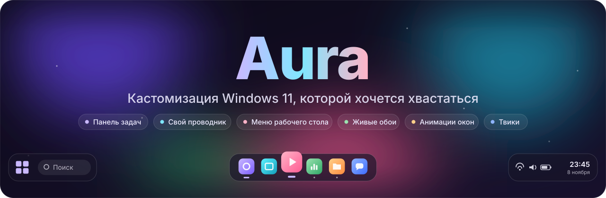
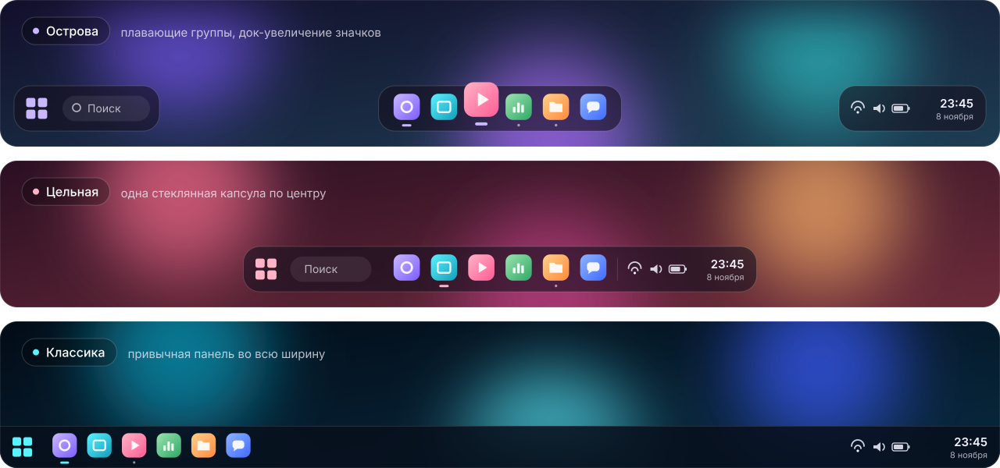
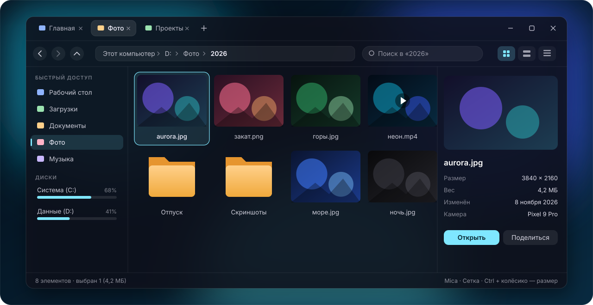
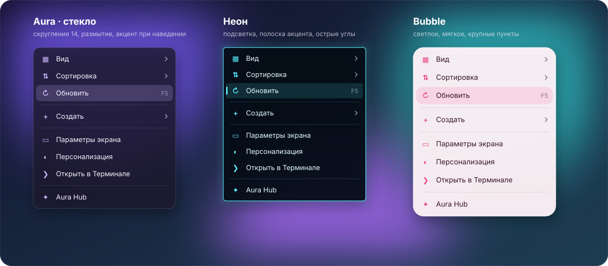
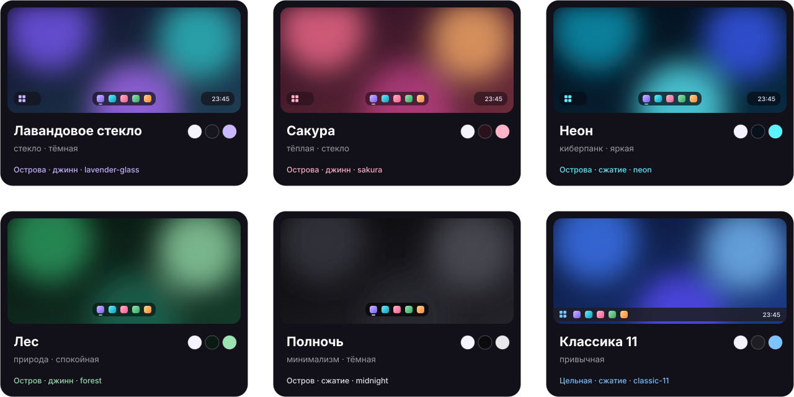
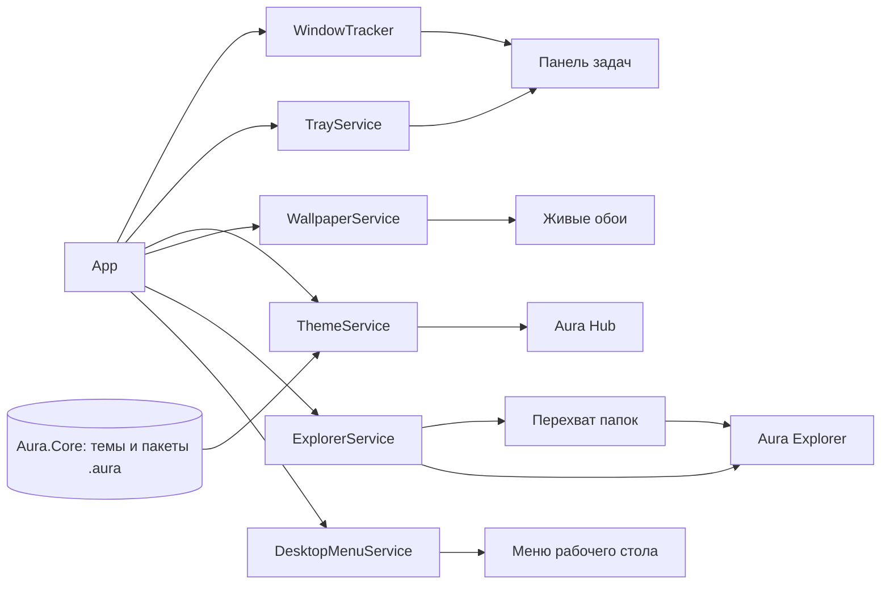

<div align="center">



<p>
<a href="https://github.com/vtat318-sketch/aura-shell/actions/workflows/build.yml"></a>


</p>

<b>Панель задач «островами» · свой проводник с вкладками · стеклянное меню рабочего стола · живые обои · анимации окон · твики Windows</b>

<sub>Без патчей Explorer и внедрения DLL — только стандартные API Windows. Одна кнопка — и всё как было.</sub>

<br><br>

<a href="#-возможности">Возможности</a> ·
<a href="#-как-это-выглядит">Как выглядит</a> ·
<a href="#-установка">Установка</a> ·
<a href="#-горячие-клавиши">Горячие клавиши</a> ·
<a href="#-безопасность-и-откат">Безопасность</a> ·
<a href="#-дорожная-карта">Дорожная карта</a> ·
<a href="#-faq">FAQ</a>

</div>

<br>

> [!NOTE]
> **Ранняя бета.** Aura развивается быстро: что-то может работать не идеально. Каждое изменение автоматически собирается в GitHub Actions — готовый `Aura.exe` всегда лежит во вкладке **Actions**.

## ✨ Возможности

<table>
<tr>
<td width="33%" valign="top">

### 🏝️ Панель задач
Три раскладки: **острова**, **цельная капсула** или **классика**. Док-увеличение значков как в macOS, живые превью окон, автоскрытие с 5 анимациями, умный фон, жесты мыши и горячие углы.

</td>
<td width="33%" valign="top">

### 📁 Aura Explorer
Свой проводник: **вкладки**, Mica и Acrylic, настоящие миниатюры, глубокий поиск, панель просмотра, пакетное переименование. Папки из любых программ открываются в нём.

</td>
<td width="33%" valign="top">

### 🖱️ Меню рабочего стола
**6 стилей** — Aura, Windows 11, Компакт, Неон, Bubble, Сплошной. Скругление, прозрачность, размытие, плотность, анимации, подсветка акцентом и свои команды.

</td>
</tr>
<tr>
<td width="33%" valign="top">

### 🌌 Живые обои
Процедурные обои, своя картинка, **видео за значками** рабочего стола и импорт видео-обоев из подписок Wallpaper Engine. Автопауза в играх и от батареи.

</td>
<td width="33%" valign="top">

### 🪄 Анимации окон
**Джинн**, сжатие и растворение при сворачивании и разворачивании через панель Aura. Живые превью каждой анимации прямо в хабе.

</td>
<td width="33%" valign="top">

### 🛠️ Твики Windows
**18 твиков** в один клик: тёмная тема, классическое контекстное меню, без рекламы и Bing, без ускорения мыши, цвет рамок и форма углов окон.

</td>
</tr>
</table>

Всё настраивается вживую в **Aura Hub** — 10 разделов:

`Пресеты` · `Панель задач` · `Поведение панели` · `Обои` · `Проводник` · `Анимации` · `Сообщество` · `Меню рабочего стола` · `Система` · `Производительность`

## 🎬 Как это выглядит

> Это векторные макеты интерфейса, нарисованные по настоящим настройкам и пресетам Aura.

<h3 align="center">Три раскладки панели задач</h3>



<h3 align="center">Aura Explorer</h3>



<h3 align="center">Меню рабочего стола на любой вкус</h3>



<h3 align="center">Шесть встроенных тем</h3>



## 🧩 Подробно

<details>
<summary><b>🏝️ Панель задач 2.0 — поведение, анимации, жесты</b></summary>

<br>

Всё настраивается в **Хаб → «Поведение панели»** и применяется сразу, без перезапуска. Рядом с настройками — живая мини-демонстрация, а кнопка **«Попробовать на панели»** проигрывает анимацию на настоящей панели.

**Автоскрытие**
- Режимы **Выкл**, **Всегда** и **Умное** — панель прячется, только если окно наезжает на неё.
- 5 анимаций появления: **Слайд**, **Пружина**, **Растворение**, **Зум**, **Скольжение**.
- Скорость, задержки появления и скрытия, высота зоны срабатывания у края.
- Светящаяся полоска-подсказка у края экрана в цвет акцента темы.
- Не выезжает в играх и полноэкранном видео, не прячется при открытом меню или превью.

**Значки и превью**
- Увеличение под курсором как в доке macOS: сила увеличения и ширина «волны».
- Значок подпрыгивает при запуске приложения.
- Живые миниатюры окон через DWM, без нагрузки на процессор. Клик — переключиться, средняя кнопка или ✕ — закрыть.

**Умный фон** — прозрачная над рабочим столом, стеклянная над окнами, сплошная над развёрнутым окном.

**Жесты мыши**
- Колёсико над панелью — громкость или переключение окон.
- Двойной клик по пустому месту — свернуть всё, Task View, поиск, хаб и т. д.
- Средняя кнопка по значку — новое окно или закрыть приложение.

**Горячие углы** — 4 угла экрана, на каждый одно из 12 действий: рабочий стол, Task View, Пуск, поиск, уведомления, виджеты, хаб Aura, проводник Aura, блокировка, скриншот, выключить звук, автоскрытие.

**Готовые профили поведения**

| Профиль | Что включает |
|---|---|
| Классика | Панель всегда видна, без лишних эффектов |
| Док как в macOS | Автоскрытие с пружиной, сильное увеличение значков, подпрыгивание |
| Умная | Умное автоскрытие, умный фон, превью |
| Игровая | Не мешает в играх, минимум анимаций, быстрые реакции |
| Минимализм | Скрытая панель, растворение, без подсказок и превью |
| Профи | Горячие углы, жесты, превью, длинная дата |

</details>

<details>
<summary><b>🪟 Окна приложений и трей — новое в 0.2</b></summary>

<br>

- Приложения, которые живут в трее (VPN, мессенджеры, лаунчеры), **разворачиваются по клику** на панели Aura: если видимого окна нет, Aura нажимает их значок в трее.
- Правый клик по значку приложения: **Развернуть**, **На весь экран**, **Свернуть / Свернуть все**, **Открыть через значок в трее**, **Закрыть окно / Закрыть все окна**, **Снять задачу**.
- Если программа запущена от администратора и не слушается, Aura предложит включить режим администратора.
- В разделе **Система** — значки трея, рамки и углы окон, тёмные заголовки и резервный запуск через трей.

</details>

<details>
<summary><b>📁 Aura Explorer — свой проводник</b></summary>

<br>

Открывается по **Win+Alt+E**, кнопкой на панели задач, из хаба, пунктом «Открыть в Aura» в меню проводника и командой `Aura.exe --open "D:\Фото"`. Если Aura уже запущена, папка откроется в ней новой вкладкой.

- **Все папки — через Aura.** Окна проводника Windows перехватываются и открываются в Aura Explorer: двойной клик по папке, «Показать в папке» из браузера, Win+E. Зажми **Shift**, чтобы открыть обычный проводник.
- Вкладки (Ctrl+T, Ctrl+W, Ctrl+Tab, средняя кнопка — в новой вкладке), несколько окон, вкладки восстанавливаются после перезапуска.
- Mica, Acrylic, Tabbed или сплошной фон с оттенком темы, скругления Windows 11.
- Сетка, плитки или таблица; размер значков ползунком или Ctrl+колёсико.
- Настоящие миниатюры фото, видео и документов через Windows Shell, в фоне и с кэшем.
- Копирование, перемещение и удаление — нативными операциями Windows: окно прогресса, корзина, отмена.
- Drag and drop внутри окна, между окнами, из и в проводник Windows, на боковую панель, «хлебные крошки» и корзину.
- Выделение рамкой, Ctrl/Shift-клики, инверсия выделения, поиск по первым буквам.
- Фильтр по мере ввода и глубокий поиск по Enter — по всем подпапкам, до 2000 результатов.
- Адресная строка: `~` — профиль, `cmd` / `powershell` / `wt` — терминал в текущей папке.
- Панель просмотра: картинка, разрешение, текст файлов, атрибуты.
- Главная: быстрый доступ, избранное, диски с заполненностью, недавние файлы.
- Ctrl+V картинки из буфера сохраняет её как PNG, текст — как .txt.
- Пакетное переименование (F2 при нескольких выделенных).
- 6 готовых стилей: Aura, Галерея, Классика, Компакт, Радуга, Фокус.

</details>

<details>
<summary><b>🖱️ Меню рабочего стола</b></summary>

<br>

- Своё меню по правому клику на рабочем столе вместо стандартного.
- **6 пресетов**: Aura, Windows 11, Компакт, Неон, Bubble, Сплошной.
- Скругление, прозрачность, размытие и его сила, плотность пунктов, значки, размер шрифта, ширина.
- Анимации появления: нет, растворение, «поп», выезд — с настройкой длительности.
- Подсветка пунктов цветом акцента, тень, живое превью в хабе.
- Можно скрыть ненужные пункты и добавить **свои команды** — любая программа с аргументами.
- Твик «Классическое контекстное меню» возвращает меню Windows 10 в проводнике.

</details>

<details>
<summary><b>🌌 Обои и Wallpaper Engine</b></summary>

<br>

- 6 собственных процедурных обоев, своя картинка, видео-обои за значками рабочего стола.
- Импорт видео-обоев из подписок Wallpaper Engine. Сцены и веб-обои пока не поддерживаются.
- Автопауза в играх, в полноэкранных приложениях и от батареи.

</details>

<details>
<summary><b>🛠️ Твики Windows — 18 штук</b></summary>

<br>

| Внешний вид | Проводник Windows | Скорость и удобство |
|---|---|---|
| Тёмная тема приложений | Классическое контекстное меню | Мгновенные подменю |
| Тёмная тема Windows | Показывать расширения файлов | Без задержки автозагрузки |
| Без эффектов прозрачности | Показывать скрытые файлы | Быстро закрывать зависшие программы |
| Цвет акцента на заголовках | «Этот компьютер» вместо «Главной» | Не спрашивать про залипание клавиш |
| «Этот компьютер» на рабочем столе | Без Bing и рекламы в поиске | Без ускорения мыши |
| Скрыть корзину с рабочего стола | | Без фоновой записи Xbox Game Bar |
| | | Без рекламы и «советов» Windows |

Каждый твик сохраняет прежнее значение в резервную копию и откатывается одной кнопкой.

</details>

<details>
<summary><b>🔋 Производительность</b></summary>

<br>

- Никаких постоянных циклов отрисовки: часы просыпаются раз в минуту.
- Превью анимаций работают только на экране, 30 кадров в секунду.
- Опрос курсора включается, только когда нужен — для автоскрытия или горячих углов.
- **Эко-режим** выключает эффекты и упрощает анимации.

</details>

## 🎨 Темы

| Тема | Раскладка | Сворачивание | Обои |
|---|---|---|---|
| 💜 Лавандовое стекло | острова | джинн | aurora |
| 🌸 Сакура | острова | джинн | sunset |
| 💠 Неон | острова | сжатие | deep |
| 🌿 Лес | остров | джинн | forest |
| 🌑 Полночь | остров | сжатие | mono |
| 🪟 Классика 11 | цельная | сжатие | bloom |

Темы — обычные JSON-файлы в [`themes/presets`](themes/presets) со схемой [`schema/theme.schema.json`](schema/theme.schema.json). В разделе **Сообщество** темы экспортируются и импортируются пакетами `.aura`.

## 🚀 Установка

### Вариант 1. Готовый Aura.exe

1. Открой вкладку **[Actions](https://github.com/vtat318-sketch/aura-shell/actions)** → последняя зелёная сборка **build**.
2. Внизу страницы, в блоке **Artifacts**, скачай `Aura-win-x64`.
3. Распакуй и запусти `Aura.exe`. Это один файл, .NET ставить не нужно.

Версии с меткой `v*` дополнительно публикуются в **[Releases](https://github.com/vtat318-sketch/aura-shell/releases)**.

### Вариант 2. Собрать самому одним двойным кликом

1. **Code → Download ZIP** и распакуй архив. Не запускай из самого архива.
2. Дважды кликни **`build.bat`**. Если появится SmartScreen — «Подробнее → Выполнить в любом случае».
3. В первый раз скрипт сам скачает .NET 8 SDK в папку `.dotnet` рядом с проектом: около 250 МБ, права администратора не нужны.
4. Скрипт соберёт `out\Aura.exe`, предложит ярлык на рабочем столе и запустит Aura. Следующие сборки — около минуты.
5. Если сборка упала, откроется `build-errors.txt` — пришли его в [Issues](https://github.com/vtat318-sketch/aura-shell/issues).

### Вариант 3. Для разработчиков

```powershell
git clone https://github.com/vtat318-sketch/aura-shell.git
cd aura-shell
.\build.ps1 -Run
```

Или открой `Aura.sln` в Visual Studio 2022 и нажми F5 — запускаемый проект `Aura.Shell`. HTML-прототип собирается командой `python tools/build.py` и открывается в браузере: `prototype/index.html`.

### Параметры запуска

| Команда | Что делает |
|---|---|
| `Aura.exe --open "<папка>"` | Открыть папку в Aura Explorer (новой вкладкой, если Aura уже запущена) |
| `Aura.exe --restore` | Вернуть Windows как было, настройки Aura остаются |
| `Aura.exe --reset` | То же самое и сбросить настройки |
| `Aura.exe --show-taskbar` | Только показать панель задач Windows |

## ⚡ Горячие клавиши

| Клавиши | Действие |
|---|---|
| <kbd>Win</kbd> + <kbd>Alt</kbd> + <kbd>E</kbd> | Открыть Aura Explorer |
| <kbd>Win</kbd> + <kbd>E</kbd> | Aura Explorer вместо проводника (включается в хабе) |
| <kbd>Shift</kbd> при открытии папки | Открыть обычный проводник Windows |

<details>
<summary><b>Клавиши в Aura Explorer</b></summary>

<br>

| Клавиши | Действие |
|---|---|
| <kbd>Alt</kbd> + <kbd>←</kbd> <kbd>→</kbd> <kbd>↑</kbd> | Назад, вперёд, вверх |
| <kbd>Ctrl</kbd> + <kbd>T</kbd> / <kbd>W</kbd> / <kbd>Tab</kbd> | Новая вкладка, закрыть, следующая |
| <kbd>Ctrl</kbd> + <kbd>1</kbd>…<kbd>9</kbd> | Перейти на вкладку |
| <kbd>Ctrl</kbd> + <kbd>L</kbd> | Адресная строка |
| <kbd>Ctrl</kbd> + <kbd>F</kbd> | Поиск |
| <kbd>Ctrl</kbd> + <kbd>H</kbd> | Скрытые файлы |
| <kbd>Ctrl</kbd> + <kbd>Shift</kbd> + <kbd>N</kbd> | Новая папка |
| <kbd>F2</kbd> | Переименовать (пакетно — при нескольких выделенных) |
| <kbd>F5</kbd> | Обновить |
| <kbd>Del</kbd> / <kbd>Shift</kbd> + <kbd>Del</kbd> | В корзину / навсегда |
| <kbd>Alt</kbd> + <kbd>P</kbd> | Панель просмотра |
| <kbd>Alt</kbd> + <kbd>Enter</kbd> | Свойства |

</details>

## 🔒 Безопасность и откат

- Aura **не патчит Explorer и не внедряет DLL** — только стандартные API Windows.
- Пункт меню проводника и автозапуск пишутся только в `HKCU` — права администратора не нужны.
- Стандартная панель задач скрывается, только пока Aura запущена, и возвращается при выходе.
- **Хаб → Производительность → Безопасность → «Вернуть всё как было»** — тот же пункт есть в меню кнопки «Пуск» Aura. Возвращаются панель задач Windows, прежние обои, убираются пункт меню и автозапуск.
- Прежние обои запоминаются при первом запуске в `%LocalAppData%\Aura\restore-point.json`.
- Настройки при сбросе переезжают в `%AppData%\Aura-backup-<дата>` — их можно вернуть.
- Если Aura совсем не запускается — `restore-windows.bat` рядом с `Aura.exe`.
- Лог ошибок: `%AppData%\Aura\aura.log`.

## 🧱 Как устроено



```
Aura.sln
src/Aura.Core/          темы: модель, загрузка, проверка, пакеты .aura
src/Aura.Shell/         приложение WPF
  Interop/              Win32: окна, app bar, звук, активация окон
  Services/             настройки, темы, окна, трей, обои, проводник, твики
  Controls/             живые превью анимаций и тем
  Views/                панель задач, проводник, хаб, меню, флайауты
  Themes/Controls.xaml  стили
themes/presets/         6 готовых тем (общие с прототипом)
schema/                 JSON Schema для тем
prototype/              HTML-прототип интерфейса
tools/                  сборка прототипа и проверка пресетов
docs/assets/            картинки для этой страницы
```

Подробнее: [`PLAN.md`](PLAN.md) — идея и архитектура, [`FEATURES.md`](FEATURES.md) — что взято из других программ, [`CHANGELOG.md`](CHANGELOG.md) — история изменений.

## 🧭 Дорожная карта

- [x] Панель задач: острова, цельная, классика
- [x] Автоскрытие, превью окон, жесты и горячие углы
- [x] Aura Explorer с вкладками и миниатюрами
- [x] Живые обои и импорт из Wallpaper Engine
- [x] Анимации сворачивания окон (бета)
- [x] Меню рабочего стола с 6 стилями
- [x] Все папки открываются в Aura Explorer
- [x] Разворачивание приложений из трея
- [x] 18 твиков Windows с откатом
- [ ] Панель на нескольких мониторах
- [ ] Своё меню «Пуск»
- [ ] Анимации открытия окон
- [ ] Экспорт и импорт всех настроек одним файлом
- [ ] Каталог тем сообщества
- [ ] Порядок пунктов и свой цвет меню рабочего стола

## ❓ FAQ

<details>
<summary><b>Антивирус или SmartScreen ругается на Aura.exe</b></summary>

<br>

Aura не подписана сертификатом, поэтому SmartScreen показывает предупреждение. Весь код открыт в этом репозитории, а `Aura.exe` собирает GitHub Actions прямо из него.

</details>

<details>
<summary><b>Панель задач Windows не вернулась</b></summary>

<br>

Запусти `Aura.exe --show-taskbar` или `restore-windows.bat`. Если не помогло — перезагрузи компьютер.

</details>

<details>
<summary><b>Приложение из трея не разворачивается</b></summary>

<br>

Правый клик по значку на панели Aura → **«Открыть через значок в трее»**. Если программа запущена от администратора, включи в хабе **Система → «Запускать Aura от администратора»**.

</details>

<details>
<summary><b>Как открыть папку в обычном проводнике?</b></summary>

<br>

Зажми **Shift**, когда открываешь папку, или выключи перехват в **Хаб → Система → «Папки открываются в Aura Explorer»**.

</details>

<details>
<summary><b>Работает ли на Windows 10?</b></summary>

<br>

Да, на Windows 10 и 11 x64. Mica, скругления и цвет рамок окон — возможности Windows 11, на Windows 10 они упрощаются.

</details>

## 🤝 Участие

Нашёл баг или есть идея — открой [Issue](https://github.com/vtat318-sketch/aura-shell/issues/new/choose), там готовые шаблоны. Как прислать изменения — в [`CONTRIBUTING.md`](CONTRIBUTING.md).

## 📄 Лицензия

[MIT](LICENSE). Обои из Wallpaper Engine принадлежат их авторам — не включай их в темы для сообщества.

<br>

<div align="center">
<sub>Сделано с 💜 для тех, кто любит красивый рабочий стол</sub>
</div>
